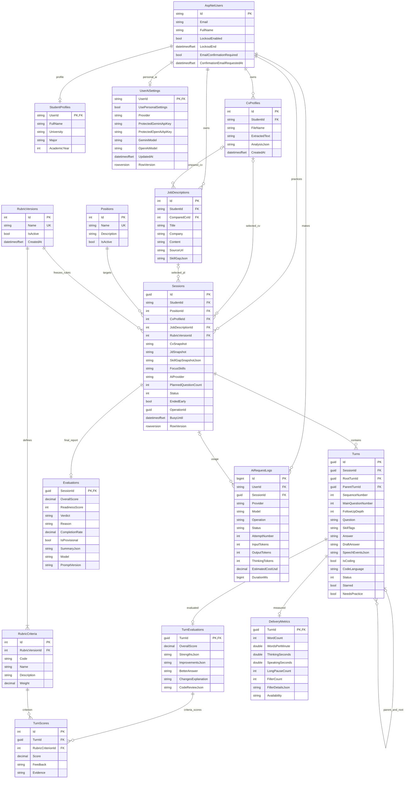
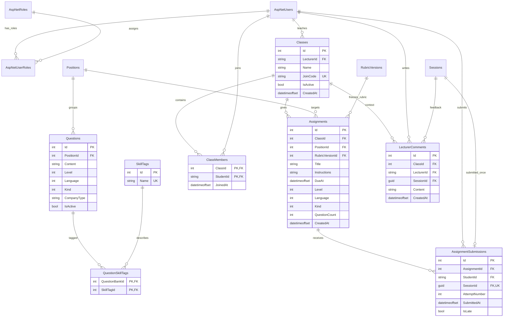

# Mô hình dữ liệu đang triển khai

Tài liệu phản ánh entity và cấu hình hiện tại trong `Models.cs`, `ApplicationUser.cs`, `UserAiSettings.cs`, `AppDbContext.cs` cùng năm migration tới **`20261013105437_AddPersonalAiSettings`**. Tên trong sơ đồ là **tên bảng SQL** từ `DbSet`; `Sessions` là `InterviewSession`, `Turns` là `InterviewTurn`, `Questions` là `QuestionBank`, `Classes` là `Classroom`.

Bộ StarUML/PDF/SQL `InterviewLab-UseCase-ERD-SQL.zip` bàn giao trước tính năng key cá nhân là ảnh chụp phiên bản trước, chưa có `UserAiSettings`. Với bản hiện tại, dùng migrations trong source để tạo/cập nhật database hoặc xuất SQL mới.

Các trường mô tả dưới đây là trường chính để đọc sơ đồ, không thay thế migration đầy đủ. Identity có thêm bảng claim, token, external login và role claim theo chuẩn ASP.NET Core Identity.

## Hồ sơ, phỏng vấn và đánh giá

`Sessions` còn lưu enum cấp độ, ngôn ngữ, hình thức, loại phỏng vấn, persona và các thời điểm tạo/bắt đầu/kết thúc. `Turns` lưu thời điểm hiển thị câu hỏi/bắt đầu trả lời/nộp. Những thời điểm tính từ browser có thể vắng mặt nếu không có telemetry hợp lệ. Trường có kiểu không-null trong sơ đồ vẫn có thể nullable trong schema; xem bảng nullable quan trọng phía dưới hoặc migration để xác nhận.

## Ngân hàng câu hỏi, lớp và bài tập

## Quyết định thiết kế so với ERD gợi ý ban đầu

| Quyết định | Lý do và hệ quả |
|---|---|
| `RubricVersion` + `RubricCriterion` thay một bảng tiêu chí duy nhất | Thay trọng số không làm thay đổi kết quả hoặc cấu hình bài tập cũ; chỉ một version active |
| Tách `TurnEvaluation` khỏi `Evaluation` toàn buổi | Lưu điểm từng lượt, viết lại và code review; lần chấm tiếp tục dùng kết quả đã lưu thay vì chấm lại tất cả |
| `Turns.SkillTags` là chuỗi phân cách bằng dấu phẩy | Lưu tag AI tại thời điểm hỏi độc lập ngân hàng; chuẩn hóa nhiều-nhiều chỉ dùng cho ngân hàng câu hỏi |
| `SpeechEventsJson` nằm trong `Turns` | Lưu các cửa sổ sự kiện microphone/nhận dạng đã kiểm tra; không có bảng audio hay file audio |
| CV/JD được chụp vào `CvSnapshot`, `JdSnapshot` | Nội dung dùng để phỏng vấn không thay đổi theo tài liệu về sau |
| `SkillGapSnapshotJson` nullable trong `Sessions` | Chỉ chụp kết quả so sánh JD khi CV đang chọn trùng `ComparedCvId`; AI đặt câu hỏi nhận bản chụp này, không dùng skill gap của một CV khác |
| `AiRequestLog.SessionId` tùy chọn | Phân tích CV hoặc skill gap cũng dùng AI nhưng không thuộc buổi phỏng vấn |
| `UserAiSettings` là quan hệ một-một tùy chọn với tài khoản | Hai key được bảo vệ riêng theo user/nhà cung cấp bằng Data Protection; `UsePersonalSettings` chọn nguồn cấu hình, `Provider` chọn Gemini/OpenAI. Không có bản ghi hoặc tắt lựa chọn cá nhân thì dùng cấu hình hệ thống |
| `UserAiSettings.RowVersion` | Ngăn ghi đè thay đổi đồng thời ở nhiều tab; xóa key đang chọn giữ chế độ cá nhân, không tự dùng key hệ thống |
| Không xóa dây chuyền bản ghi nghiệp vụ | Giữ bằng chứng học tập và tránh multiple cascade paths của SQL Server; dịch vụ kiểm tra liên kết trước khi xóa |
| `AssignmentSubmission.SessionId` unique | Một buổi chỉ nộp một lần cho một bài; lần luyện lại là một session mới |

## Ràng buộc quan trọng

- `StudentProfiles.UserId`, `UserAiSettings.UserId`, `TurnEvaluations.TurnId`, `Evaluations.SessionId`, `DeliveryMetrics.TurnId` vừa là khóa chính vừa là khóa ngoại cho quan hệ một-một.
- Unique: tên vị trí, tên skill, tên rubric, một rubric đang active; `(RubricVersionId, Code)`; `(SessionId, SequenceNumber)`; `(TurnId, RubricCriterionId)`; mã lớp; `(AssignmentId, StudentId, AttemptNumber)`.
- Khóa chính ghép: `ClassMembers(ClassId, StudentId)` và `QuestionSkillTags(QuestionBankId, SkillTagId)`.
- Check constraint: câu chính/bài tập 5–10; follow-up depth 0–2; thứ tự câu dương; điểm 0–10; readiness 0–100; completion 0–100; trọng số và delivery không âm.
- `RowVersion`, `OperationId`, `BusyUntil` hỗ trợ kiểm soát thao tác đồng thời. Các quy tắc chủ sở hữu, đúng cấu hình bài nộp, quyền giảng viên và tính đầy đủ của JSON được kiểm tra tại service/server, không chỉ dựa vào UI.
- Các khóa ngoại nghiệp vụ có `DeleteBehavior.NoAction`; xóa trực tiếp bản ghi được tham chiếu sẽ bị SQL Server từ chối.
- `UserAiSettings.UserId` dùng `ON DELETE CASCADE`: khi một tài khoản đủ điều kiện được xóa, metadata/key cá nhân cũng được xóa. Các ràng buộc lịch sử học tập khác vẫn được giữ.
- `CK_UserAiSettings_Provider` chỉ nhận `Gemini` hoặc `OpenAI`; mỗi model dài tối đa 100 ký tự. Hai cột `Protected...ApiKey` nullable lưu chuỗi đã mã hóa, không phải API key nguyên văn. Sao lưu SQL phải đi cùng Data Protection key ring để có thể khôi phục key; xem [AI-SETTINGS.vi.md](AI-SETTINGS.vi.md).

Nullable đáng chú ý: CV/JD được chọn trong session, `ComparedCvId`, root/parent turn, answer/draft/code language, các thời điểm chưa xảy ra, analysis JSON chưa gọi AI, token/chi phí chưa biết, và số đo giọng nói chưa thu thập. `null` nghĩa là chưa có/không đủ dữ liệu, không tương đương số 0.

Phân quyền không được thể hiện đầy đủ bằng sơ đồ: sinh viên xem dữ liệu mình; giảng viên xem sinh viên thuộc lớp mình sau khi sinh viên đồng ý tham gia; admin quản lý hệ thống. SQL lưu timestamp bằng `datetimeoffset`; giao diện lớp/lịch sử hiển thị UTC+7.
